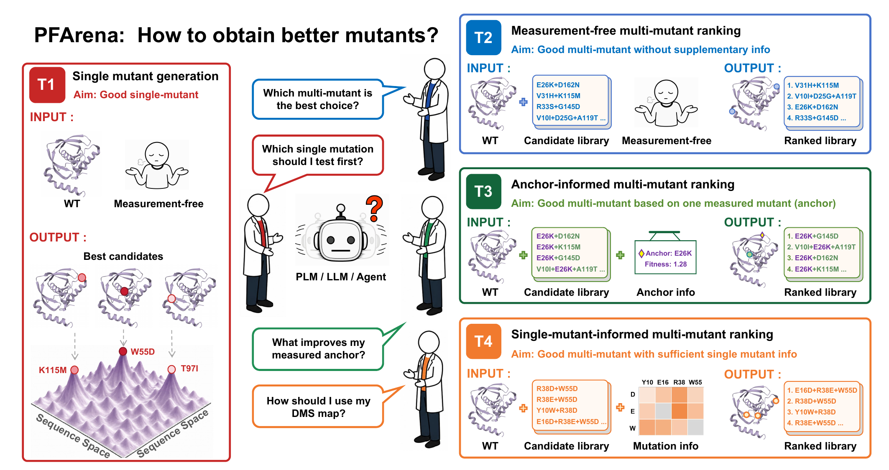

# PFArena



**PFArena** is an assay-grounded **protein-mutation benchmark** that systematically evaluates protein language models (PLMs), large language models (LLMs), and LLM-based agents under four protein modification settings. Comprising 202 unique assays, 293 assay--task instances, and 607,269 target candidate rows, PFArena defines four task interfaces that correspond to common decisions in protein-engineering workflows.

Runnable inference and evaluation code is under [`code/`](code/). Below is a detailed setup tutorial. 

## 1. Create Conda environment

Create one Python 3.12 environment for the API LLM, Agent, and evaluator code.
The pinned dependencies are in [`code/requirements.txt`](code/requirements.txt).

```bash
cd /path/to/PFArena
export PF_REPO="$PWD"
conda create --name pfarena python=3.12 -y
conda activate pfarena
python -m pip install --upgrade pip
python -m pip install --requirement code/requirements.txt
export PYTHONPATH="$PF_REPO/code${PYTHONPATH:+:$PYTHONPATH}"
```

Do not install PLM dependencies into this environment. Each PLM has its own
Conda specification, described in the [PLM inference](#plm-inference) section.

## 2. Download PFArena benchmark data

Download the `PFArena` dataset from
[`AMix-Bio/PFArena`](https://huggingface.co/datasets/AMix-Bio/PFArena) before
running inference or evaluation:

```bash
export PF_DATA="$PF_REPO/PFArena"

# Install the Hugging Face CLI if it is not already available.
python -m pip install --upgrade huggingface_hub
# Run `hf auth login` first if the dataset requires authentication.
hf download AMix-Bio/PFArena \
  --repo-type dataset \
  --local-dir "$PF_DATA"

# The download should contain these files/directories.
test -f "$PF_DATA/T1_single_mutant_generation/assay.csv"
test -d "$PF_DATA/T1_single_mutant_generation/norm_data"
```

The examples below assume that the dataset is
downloaded to `PFArena/PFArena` relative to this repository, structured as below:

```text
PFArena/
├── README.md
├── code/                       # inference and evaluation code
└── PFArena/                    # downloaded benchmark data ($PF_DATA)
    ├── assay.csv
    ├── assay_columns.md
    ├── norm_data_columns.md
    ├── T1_single_mutant_generation/
    │   ├── assay.csv
    │   └── norm_data/
    │       └── <assay_id>.csv
    ├── T2_measurement_free_multi_mutant_ranking/
    │   ├── assay.csv
    │   └── norm_data/
    │       └── <assay_id>_random_multi.csv
    ├── T3_anchor_informed_multi_mutant_ranking/
    │   ├── assay.csv
    │   └── norm_data/
    │       └── <assay_id>/
    │           └── anchor_successor.csv
    ├── T4_single_mutant_informed_multi_mutant_ranking/
    │   ├── assay.csv
    │   └── norm_data/
    │       └── <assay_id>/
    │           ├── single_context_combo.csv
    │           └── single_mutant_context.csv
    └── msa_mmseqs_uniref100/
        └── a3m_by_assay_id_relaxed_all_e01/
            └── <source_dataset>/
                └── <assay_id>.a3m
```

If the downloaded files are placed elsewhere, set `PF_DATA` to that directory
before inference. The four task directories are:

| Task | Directory | Task purpose |
| --- | --- | --- |
| T1 | `T1_single_mutant_generation` | Propose promising mutations without target-specific mutation measurements |
| T2 | `T2_measurement_free_multi_mutant_ranking` | Prioritize a supplied pool of multi-mutant candidates |
| T3 | `T3_anchor_informed_multi_mutant_ranking` | Rank successors of an experimentally measured mutant |
| T4 | `T4_single_mutant_informed_multi_mutant_ranking` | Prioritize combinations using measured effects of their component mutations |

The `norm_data` tables contain the candidate mutations; `DMS_score` is the
ground-truth label used by evaluation. Keep the downloaded benchmark data
unchanged and DO NOT expose ground-truth columns to an inference backend.

## 3. Inference

Now you are ready for **PFArena** benchmark evaluation. Code for the evaluated models in our paper is provided in this repository, and inference demos of the three model families are presented below, bonded with a shared evaluator. Feel free to skip to your section of interest.

### LLM inference

The API runner uses an OpenAI-compatible endpoint. Setup the endpoint `API_BASE_URL` and key `API_KEY` in the environment, or directly in `code/llm/settings.py` where it is read.

```bash
export API_BASE_URL="https://your-openai-compatible-endpoint/v1"
export API_KEY="<your-api-key>"
```

**All Tasks:** The supplied wrapper is [`code/llm/run_infer_api_mutation.sh`](code/llm/run_infer_api_mutation.sh).
For concurrent inference of all 4 tasks (note that this may be API cost-heavy),
edit its `model` variable, then run it from the repository root. The `task_ids`
are already set to run all tasks.

```bash
cd "$PF_REPO"
bash code/llm/run_infer_api_mutation.sh
```

**Single Task**: Or run each task separately, by changing `task_id` from 1 to 4 in the python script as follows:

```bash
# T1, change task-id from 2-4 for the other tasks
python code/llm/infer_api_mutation.py \
  --model gpt-6-astra \
  --task-id 1 \
  --num-workers 32 \
  --retry-runs 10
```

**Inference Results**: Outputs are written as one CSV per assay under
`code/llm/results/<model>/<task_name>/norm_data/`. Existing non-empty output files are
skipped; add `--force` to recompute them. Use `--max-files` for a smoke test,
and lower `--num-workers` when the endpoint has a strict rate limit.

### Agent inference

The Agent runner wraps Biomni and supports DeepSeek, GPT, and Claude through an
OpenAI-compatible interface. The provider presets in `code/agent/run.py` map
to these variables:

| Provider | Model preset | API key variable | Base URL variable |
| --- | --- | --- | --- |
| `deepseek` | `deepseek-chat` | `DEEPSEEK_API_KEY` | `DEEPSEEK_BASE_URL` |
| `gpt` | `gpt-4o` | `OPENAI_API_KEY` | `OPENAI_BASE_URL` |
| `claude` | `claude-3-5-sonnet-latest` | `CLAUDE_API_KEY` | `CLAUDE_BASE_URL` |

Set the variables for the provider you will use. `BIOMNI_PROJECT_ROOT` is the
project root used by Biomni tools; `BIOMNI_DATA_ROOT` is a convenient default
for the benchmark location.

```bash
cd "$PF_REPO/code/agent"
# Point this to the Biomni project/tool root used by your installation.
export BIOMNI_PROJECT_ROOT="/path/to/your/biomni/project"
export BIOMNI_DATA_ROOT="$PF_DATA"
export BIOMNI_RESULT_ROOT="$PF_REPO/code/agent/results"
export DEEPSEEK_API_KEY="<your-api-key>"
export DEEPSEEK_BASE_URL="https://api.deepseek.com"
```

Run one task with `run.py`. The `--data-dir` and output paths are explicit here
so that the result can be evaluated without renaming files later.

```bash
# T1 smoke test: one query, no optional tool retriever calls.
python run.py \
  --task T1_single_mutant_generation \
  --provider deepseek \
  --data-dir "$PF_DATA/T1_single_mutant_generation" \
  --max-items 1 \
  --no-use-tool-retriever \
  --output-csv "$PF_REPO/code/agent/results/T1_single_mutant_generation/T1_single_mutant_generation_agent_native_deepseek_v4_pro_predictions.csv"

# Full runs use the same form; replace TASK with one of the four task names.
TASK=T2_measurement_free_multi_mutant_ranking
python run.py \
  --task "$TASK" \
  --provider deepseek \
  --data-dir "$PF_DATA/$TASK" \
  --output-csv "$PF_REPO/code/agent/results/$TASK/${TASK}_agent_native_deepseek_v4_pro_predictions.csv"
```

Use `--provider gpt` or `--provider claude` after setting the corresponding
API variables. For a custom OpenAI-compatible model, pass
`--agent-llm`, `--agent-base-url`, and `--agent-api-key-env` instead of a
provider preset. Each task also has a standalone script, for example
`run_T1_single_mutant_generation_agent_native.py`.

The Agent writes a prediction CSV plus an audit JSONL and an execution log.
Keep the audit and log files beside the predictions; they are useful for
checking tool calls, failures, and resumable runs. `--resume-existing` can
continue a partially completed run. GPU dispatch is optional and disabled by
default; enable it only after configuring a compatible dispatcher and shared
job directory (see [`code/agent/README.md`](code/agent/README.md)).

### PLM inference

PLMs are deliberately isolated from the shared `pfarena` environment. The
environment files under
[`code/plm/environments/`](code/plm/environments/) pin the Python, PyTorch,
CUDA, and model-specific dependencies required by each baseline.

Create only the environments you need; the name is stored in each YAML file:

```bash
cd "$PF_REPO"
PLM_ENV_FILE="code/plm/environments/esm2.yml"
conda env create --file "$PLM_ENV_FILE"
conda activate pfarena-esm2
```

The same command works for `progen2_base.yml`, `prosst_2048.yml`, `s3f.yml`,
`s3f_msa.yml`, and `venusrem.yml`. Do not mix packages between these
environments. Model weights and upstream repositories are not bundled; obtain
them from the official sources listed in
[`code/plm/docs/DEPENDENCIES.md`](code/plm/docs/DEPENDENCIES.md).

Prepare the PLM input tables from the same Hugging Face download used above.
This CPU-only step requires pandas and validates sequences, mutations and MSAs;
it does not run a model or copy the benchmark, MSAs or PDBs. Candidate fitness
labels are excluded from model inputs. Run it once for all six baselines:

```bash
export PLM_DATA="$PF_REPO/work/plm_inputs"
python "$PF_REPO/code/plm/prepare_dataset.py" \
  --benchmark-root "$PF_DATA" \
  --output-dir "$PLM_DATA" \
  --structure-manifest "$PF_DATA/Structures_alphafold3/manifest.csv"
export PLM_STRUCTURES="$PLM_DATA/structures.csv"
```

The output directory must not already exist. It contains `dataset.json`,
the canonical CSV tables and a validated local structure manifest. Pass
`--structure-manifest "$PLM_STRUCTURES"` to the structure-aware preparation
or inference scripts. Keep the relative locations of the downloaded data and
generated input directory unchanged, or regenerate the inputs after moving them.

For a sequence-only baseline, run all shards with the same `--num-shards` and
distinct `--shard-id` values. The model directory, cache directory, and output
directory must contain the resources expected by that model.

```bash
conda activate pfarena-esm2
export PLM_WORK="$PF_REPO/work/plm"
mkdir -p "$PLM_WORK"

python code/plm/models/esm2/run_candidates.py \
  --dataset-dir "$PLM_DATA" \
  --output-dir "$PLM_WORK/esm2" \
  --model-dir /path/to/esm2_t33_650M_UR50D \
  --cache-dir "$PLM_WORK/cache/esm2" \
  --num-shards 1 \
  --shard-id 0
```

The other direct runner entry points are:

```text
code/plm/models/progen2_base/run_candidates.py
code/plm/models/prosst_2048/run_candidates.py
code/plm/models/s3f/run_candidates.py
code/plm/models/venusrem/run_candidates.py
```

ProSST-2048, S3F, and VenusREM additionally require structure/model resources;
S3F-MSA requires the staged EVE workflow. Follow the complete command
sequences in [`code/plm/docs/RUNNING.md`](code/plm/docs/RUNNING.md), including
input preparation, structure/MSA manifests, sharding, and finalization.

After all shards for a model finish, finalize the run into evaluator-ready
task tables:

```bash
python code/plm/finalize_results.py \
  --dataset-dir "$PLM_DATA" \
  --run-dir "$PLM_WORK/esm2" \
  --output-schema code/plm/models/esm2/output_schema_candidates.json
```

Finalization validates shard coverage, sample identity, score direction, and
the model output schema. Do not evaluate an incomplete run as if missing rows
were zero.

For model-specific inputs, dependency versions, output schemas, and resource
provenance, see the documentation under [`code/plm/docs/`](code/plm/docs/).

## 4. Evaluation

The shared evaluator is wrapped by
[`code/evaluation/run_evaluate.sh`](code/evaluation/run_evaluate.sh). It uses
the downloaded `PFArena/PFArena` directory as ground truth by default. Set
`GROUND_TRUTH_DIR` when the benchmark is elsewhere. The wrapper currently
passes `--lenient`, which replaces unavailable assays with a random result
when coverage is incomplete; remove that flag in the wrapper or call
`evaluation.evaluate` directly for strict coverage checking.

### Evaluate LLM predictions

When `SETTING` is empty, all four tasks are evaluated.
Run the following command for default paths:

```bash
cd "$PF_REPO"
MODEL="gpt-6-astra" \
bash code/evaluation/run_evaluate.sh
```

Set `SETTING` to the corresponding full task directory name to evaluate a
single task, which are
`T1_single_mutant_generation`,
`T2_measurement_free_multi_mutant_ranking`,
`T3_anchor_informed_multi_mutant_ranking`, and
`T4_single_mutant_informed_multi_mutant_ranking`

```bash
cd "$PF_REPO"
MODEL=gpt-6-astra \
SETTING=T1_single_mutant_generation \
RESULTS_SOURCE=llm \
RESULTS_ROOT="$PF_REPO/code/llm/results" \
GROUND_TRUTH_DIR="$PF_DATA" \
bash code/evaluation/run_evaluate.sh
```

The evaluator expects the LLM files at
`<RESULTS_ROOT>/<MODEL>/<SETTING>/norm_data/`.

### Evaluate Agent predictions

Set `AGENT_PREDICTIONS_NAME` to the filename passed to `--output-csv`:

```bash
MODEL=deepseek-v4-pro \
SETTING=T1_single_mutant_generation \
RESULTS_SOURCE=agent \
RESULTS_ROOT="$PF_REPO/code/agent/results" \
AGENT_PREDICTIONS_NAME=T1_single_mutant_generation_agent_native_deepseek_v4_pro_predictions.csv \
GROUND_TRUTH_DIR="$PF_DATA" \
bash "$PF_REPO/code/evaluation/run_evaluate.sh"
```

The Agent result directory is expected to be
`<RESULTS_ROOT>/<SETTING>/`.

### Evaluate PLM predictions

After `finalize_results.py` creates
`<RESULTS_ROOT>/<MODEL>/tasks/<SETTING>/evaluator_predictions.csv`, run:

```bash
MODEL=esm2 \
SETTING=T1_single_mutant_generation \
RESULTS_SOURCE=plm \
RESULTS_ROOT="$PF_REPO/work/plm" \
GROUND_TRUTH_DIR="$PF_DATA" \
bash "$PF_REPO/code/evaluation/run_evaluate.sh"
```

Evaluation writes `summary_metrics.json`, `summary_metrics.csv`, and
`per_assay_metrics.csv` under the selected output directory. T1 reports
`NMS@40` and `Recall@40`; T2--T4 report global ranking agreement
(`spearman`, `NDCG`) and top-five quality/recovery (`NMS@5`, `Recall@5`).

### Average NMS score evaluation

We summarize overall model performance using the **unweighted average NMS**
across T1--T4: `NMS@40` for T1 and `NMS@5` for T2--T4. Each task contributes
equally, regardless of its number of assays:

```text
Average NMS = (NMS@40_T1 + NMS@5_T2 + NMS@5_T3 + NMS@5_T4) / 4
```

These metrics summarize the ground-truth quality of the candidates selected
within each task's evaluation budget. Run the evaluator for all four tasks
first, then pass the directory containing their task folders to
[`code/evaluation/average_nms.sh`](code/evaluation/average_nms.sh):

```bash
export PF_RESULTS=/path/to/model_results
bash "$PF_REPO/code/evaluation/average_nms.sh" "$PF_RESULTS"
```

The script reads `metrics` from each task's `evaluation/summary_metrics.json`
and requires exactly four matching summaries. The expected layout is:

```text
<PF_RESULTS>/
├── T1_single_mutant_generation/evaluation/summary_metrics.json
├── T2_measurement_free_multi_mutant_ranking/evaluation/summary_metrics.json
├── T3_anchor_informed_multi_mutant_ranking/evaluation/summary_metrics.json
└── T4_single_mutant_informed_multi_mutant_ranking/evaluation/summary_metrics.json
```

For example, GPT-6-Astra produces:

```text
T1_single_mutant_generation: 0.796556
T2_measurement_free_multi_mutant_ranking: 0.796711
T3_anchor_informed_multi_mutant_ranking: 0.825769
T4_single_mutant_informed_multi_mutant_ranking: 0.893460
Average NMS: 0.8281
```

## 5. Citation

If you find PFArena useful, please kindly cite our paper:

```text
@article{ouyang2026pfarena,
  title={PFArena: Benchmarking Language Models for Protein Modification},
  author={Ouyang, Yawen and Zhang, Xinbo and Ma, Ziyuan and Wu, Yixin and Liao, Wenbin and Zhang, Feiran and Li, Wenjie and Wang, Lihao and Wang, Hao and Zheng, Xiaoqing and others},
  journal={arXiv preprint arXiv:2609.28921},
  year={2026}
}
```
